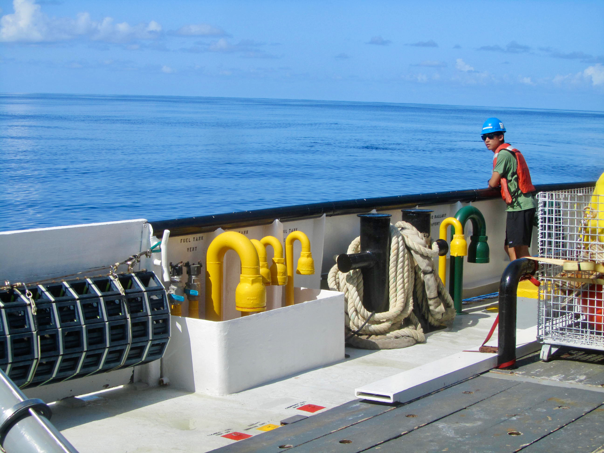

# BIOS-SCOPE - Integrated Science in the Sargasso Sea


Since 2015, [Dr. Craig Carlson](https://bios.asu.edu/about/team-members/craig-carlson) has led the [BIOS-SCOPE program](https://bios.asu.edu/scope/about), bringing together an international team of researchers with expertise spanning microbial evolution, cell biology, biochemistry, marine chemistry, and geochemistry. Based at Arizona State University's Bermuda Institute of Ocean Sciences (ASU BIOS), the program draws on the institute's oceanographic and laboratory facilities and the extensive observational record of the surrounding Sargasso Sea.

BIOS-SCOPE focuses on the seasonally oligotrophic northwestern Sargasso Sea, a region characterized by deep winter mixing and strong summer stratification. Building on decades of observations from the [The Bermuda Atlantic Time-series Study (BATS)](https://bios.asu.edu/bats), the program investigates the biological and chemical processes that regulate elemental cycling in oligotrophic ocean gyres, which cover much of the global ocean.

Through coordinated field observations and experiments, BIOS-SCOPE investigates the sources, transformations, and fate of dissolved and particulate organic matter from the sunlit surface ocean to the deep sea. Molecular approaches, including metagenomics and proteomics, help connect these biogeochemical processes to the composition and activity of microbial, fungal, phytoplankton, and zooplankton communities.

In its third phase, BIOS-SCOPE is building on these observations to better understand the mechanisms governing organic matter cycling and how they respond to environmental variability and ecosystem change.


```{r, echo=FALSE, fig.cap= "In 2013, my first research cruise through BIOS, during the summer course Microbial Oceanography: The Biogeochemistry, Ecology, and Genomics of Oceanic Microbial Ecosystems, sparked my path into oceanography. I’m grateful to return to BIOS and contribute to its leadership in ocean science and education.", out.width = '90%', fig.align='center'}

```

Within BIOS-SCOPE, my research focuses on understanding how marine microbial communities transform dissolved organic matter (DOM) and influence its persistence in the ocean. I use traditional remineralization experiments alongside [continuous-flow marine bioreactors](https://doi.org/10.1029/2026JG009771) to investigate the bioavailability of DOM and the processes controlling microbial carbon consumption. These approaches provide complementary ways to examine organic matter transformations, from longer-term incubations to experiments that can resolve microbial processing over much shorter timescales.

I also lead efforts to expand underway bio-optical observations at BIOS, combining continuous measurements of seawater optical properties with discrete biological and biogeochemical sampling. By connecting these observations with laboratory experiments and satellite ocean color measurements, we aim to better understand how microbial and plankton communities influence the optical and biogeochemical properties of seawater.


## Outreach and Media

- [ASU BIOS Radio Spot on Ocean 89 | World Ocean Day](https://www.youtube.com/watch?v=bVcBA423noM)
- [HSBC ASU BIOS Presentation](https://bernews.com/2026/06/photos-hsbc-hosts-asu-bios-presentation/)