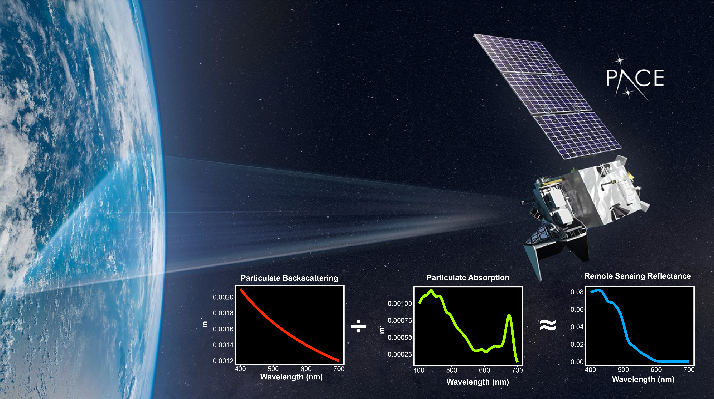

# Diel phytoplankton bio-optical properties

```{r, echo=FALSE, fig.cap= "Remote sensing reflectance (Rrs) describes the water-leaving radiance relative to the downwelling irradiance and is a fundamental quantity measured by ocean color satellites, including NASA's PACE mission. Changes in phytoplankton light absorption and scattering can influence this signal, including variability associated with species composition and daily physiological cycles.", out.width = '90%', fig.align='center'}

```

How do marine phytoplankton change from day to night, and why does it matter for satellite ocean color observations? Satellites use measurements of ocean color to estimate phytoplankton biomass and productivity, but these organisms are constantly changing over a 24-hour period. Daily cycles in cell growth, division, and physiology can alter how phytoplankton absorb and scatter light, potentially influencing the signals observed from space.

In a [NASA-funded laboratory study](https://doi.org/10.1002/lno.12493), we investigated diel (day–night) changes in the bio-optical properties of three ecologically important phytoplankton species. We found that some optical properties varied by as much as threefold over a single day, reflecting changes in cell morphology, composition, and photophysiology. Importantly, the timing and magnitude of these changes differed among species. This work provided the first culture-based characterization of full diel cycles in particulate backscattering, highlighting the importance of phytoplankton physiology and community composition when interpreting ocean color observations.

Building on this work, we are interested in understanding how diel variability manifests in natural plankton communities, where changes in physiology, community composition, and ecological processes can occur simultaneously. Through our [PACE Validation Science Team research](https://nbaetge.github.io/pvst.html), we combine high-frequency bio-optical observations with discrete biological and biogeochemical measurements to better distinguish the processes driving variability in optical signals and evaluate their implications for satellite-derived estimates of ocean properties.

 <!-- Video section -->
<div style="flex: 0 0 250px; min-width: 200px;">
  <video autoplay muted loop playsinline controls style="width: 100%; max-height: 500px; object-fit: contain; border-radius: 8px; background-color: black;">
  <source src="movies/o2cfloats.mov" type="video/mp4">
  Your browser does not support the video tag.
</video>

  <p style="font-size: 14px;  color: #6d6e71; margin-top: 10px;">
  A short reel from a 38 day research cruise in the South Pacific focused on diel sampling where we made bio-optical measurements and collected samples to develop a new method for examining the macromolecular composition (i.e, lipids, proteins, carbohydrates) of phytoplankton cells.
  </p>
</div>