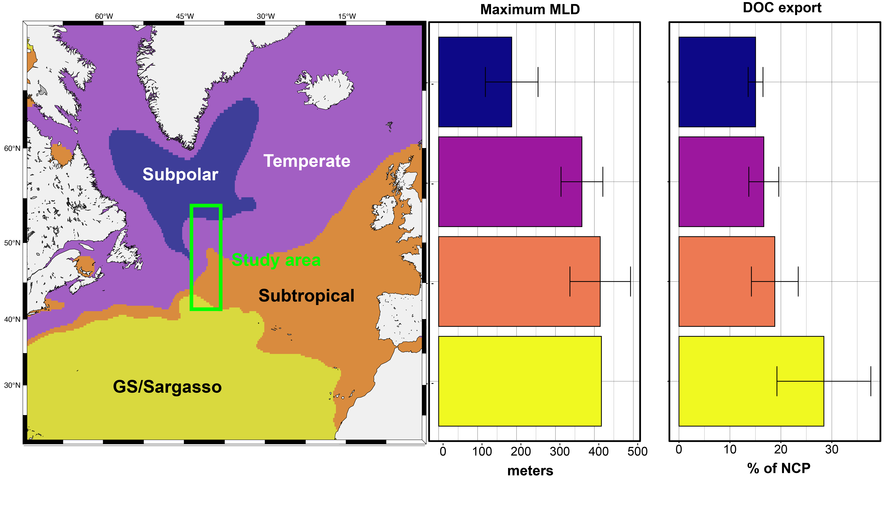

# North Atlantic Aerosols and Marine Ecosystems Study


Each spring, the North Atlantic Ocean comes alive with one of the largest phytoplankton blooms on Earth, an explosion of microscopic life that draws carbon dioxide from the atmosphere and converts it into organic matter. But what happens to all that carbon once it's fixed? My doctoral research focused on one important piece of this puzzle: dissolved organic carbon (DOC) and the microbial and physical processes that determine whether it is consumed, accumulates near the surface, or is transported into the deep ocean.

Through the NASA-led [North Atlantic Aerosols and Marine Ecosystems Study (NAAMES)](https://science.larc.nasa.gov/naames/), which combined shipboard sampling, autonomous floats, aircraft, and satellite observations, I investigated how DOC production, bioavailability, and export vary across seasons and oceanographic conditions. This research, supported by the National Science Foundation and described in my [dissertation](https://www.proquest.com/docview/2596621124?pq-origsite=gscholar&fromopenview=true), led to several key findings.

In one [study](https://doi.org/10.3389/fmars.2020.00227), we developed an approach to estimate DOC export by combining observations from autonomous Argo floats with discrete seawater measurements. This allowed us to assess how seasonal changes in ocean mixing influence the transport of organic carbon below the surface, even in regions without continuous DOC observations.

```{r, echo=FALSE, fig.cap="DOC export as a percentage of net community production (NCP), estimated from the surface to the annual maximum mixed layer depth (MLD) across the NAAMES study region. Autonomous Argo float observations were used to estimate seasonal mixing depths and place discrete biogeochemical measurements in a broader physical context.", out.width = '100%', fig.align='center'}

```

In a second [study](https://doi.org/10.3389/fmars.2020.00227), we investigated how the relationship between phytoplankton production and bacterial carbon consumption changes over the course of the annual bloom. As the bloom declined, bacterial carbon demand became more closely coupled to primary production, while a fraction of the DOC pool remained resistant to microbial consumption over the timescales of our experiments. These findings suggest that seasonal changes in microbial activity and organic matter bioavailability can influence DOC accumulation and its potential for subsequent export.

```{r, echo=FALSE, fig.cap="Dissolved organic carbon remineralization by heterotrophic bacteria during seawater incubation experiments lasting weeks to months. These experiments helped estimate the fraction of DOC resistant to microbial consumption over the incubation period and how its bioavailability varied seasonally.", out.width = '100%', fig.align='center'}
knitr::include_graphics("figures/doc_bioav3.png")
```

In a third [study](https://www.frontiersin.org/articles/10.3389/fmicb.2021.669883/abstract), we examined bacterioplankton responses to deep convective mixing, capturing rare observations of how microbial communities respond when organic matter and microorganisms are redistributed through the water column. These observations revealed rapid changes in microbial production and carbon processing associated with physical mixing.

Together, these studies demonstrate how microbial activity and ocean mixing interact to influence the fate of organic carbon. They also provide a foundation for my current research at BIOS, where I continue to investigate the processes controlling DOC bioavailability and persistence in the Sargasso Sea through [BIOS-SCOPE](https://nbaetge.github.io/BIOSSCOPE.html).


## Outreach and Media

We shared updates from our expeditions through [NASA’s Earth Observatory field blogs](https://earthobservatory.nasa.gov/blogs/fromthefield/category/naames/).

[Dr. James Allen](https://scholar.google.com/citations?user=XRYCd48AAAAJ&hl=en&oi=sra) and I were interviewed about the project on the [*Sisters of the Blue podcast*](https://podcast.app/plankton-from-outer-space-e25700142/).

Dr. Craig Carlson and I also participated in a [Smithsonian initiative](https://ocean.si.edu/ocean-life/microbes
) led by [Dr. Alyson Santoro](https://santorolab.eemb.ucsb.edu), which included a short film by filmaker [Brendan Byrne](https://youtu.be/3kvTKCOdi-c).
\
<center><iframe width="560" height="315" src="https://www.youtube.com/embed/3kvTKCOdi-c?si=_U3wXkbSxMmUbWa0" frameborder="0" allow="accelerometer; autoplay; encrypted-media; gyroscope; picture-in-picture" allowfullscreen></iframe></center>
\
Journalist [Nicole Estaphan](https://www.ksbw.com/news-team/a0dbf6cc-afdb-4b7f-bb98-7f50aab6249a) joined us during NAAMES and produced a series of stories about the expedition and its science.

<center><iframe width="560" height="315" src="https://www.youtube.com/embed/Fp3bNkXzbLI" frameborder="0" allow="accelerometer; autoplay; encrypted-media; gyroscope; picture-in-picture" allowfullscreen></iframe></center>
\
<center><iframe width="560" height="315" src="https://www.youtube.com/embed/YKbHJHfChSw" frameborder="0" allow="accelerometer; autoplay; encrypted-media; gyroscope; picture-in-picture" allowfullscreen></iframe></center>
\
<center><iframe width="560" height="315" src="https://www.youtube.com/embed/gUUoa9JgujE" frameborder="0" allow="accelerometer; autoplay; encrypted-media; gyroscope; picture-in-picture" allowfullscreen></iframe></center>
\
<center><iframe width="560" height="315" src="https://www.youtube.com/embed/O5QAg8L_xNM" frameborder="0" allow="accelerometer; autoplay; encrypted-media; gyroscope; picture-in-picture" allowfullscreen></iframe></center>

