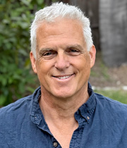
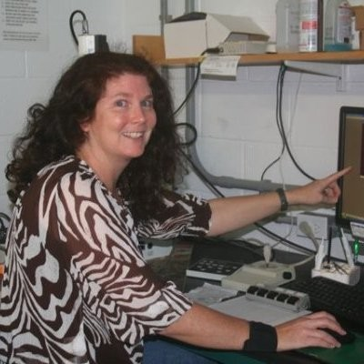
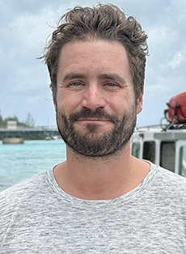
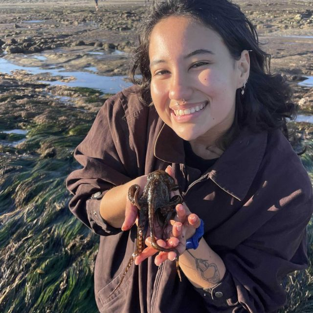
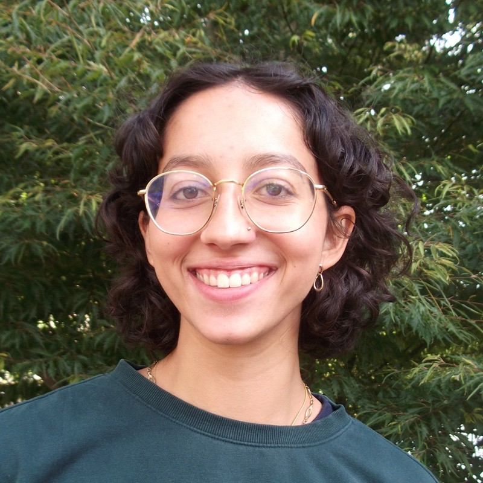

<!-- HEADER + PROFILE PHOTO SIDE-BY-SIDE -->
<div style="display: flex; align-items: center; flex-wrap: wrap; margin-bottom: 20px;">

  <!-- Circular profile photo -->
<div style="flex: 0 0 180px; margin-right: 25px;">
  
</div>
  <!-- Name and Titles on the right --> 
 <div style="flex: 1 1 280px;">
  <h1 style="font-size: 34px; margin-top: 0; margin-bottom: 8px;">
    Baetge Lab
  </h1>

  <h2 style="font-size: 22px; margin-top: 0; margin-bottom: 8px;
             font-weight: normal; color: #00a88f;">
    Microbial &amp; Bio-Optical Oceanography
  </h2>

  <p style="font-size: 17px; margin-top: 0; margin-bottom: 5px;
            color: #6d6e71;">
    ASU Bermuda Institute of Ocean Sciences
  </p>

  <p style="font-size: 15px; margin-top: 0; margin-bottom: 0;
            color: #6d6e71;">
    Dr. Nick Baetge | Assistant Research Scientist
  </p>
</div> </div>
  <p style="font-size: 14px;color: #00a88f; margin-top: 10px;">
  “Being a scientist and sailor is too good to be true.” — Roger Revelle  
  <br>
</p>


<!-- Text section -->
<div style="flex: 1 1 400px; min-width: 300px;">
  <p>
      My research explores how marine microorganisms influence the cycling
and fate of organic carbon in the ocean. By integrating long-term
ocean observations, laboratory experiments, and emerging bio-optical
technologies, I investigate how microbial communities respond to
environmental change and how their activity shapes ocean
biogeochemistry.
  </p>

  <p>
      At the ASU Bermuda Institute of Ocean Sciences, I work with an
interdisciplinary team to investigate organic matter cycling in the
Sargasso Sea. My current research focuses on understanding the
processes that control dissolved organic matter bioavailability,
developing experimental approaches to measure microbial carbon
consumption, and expanding our ability to observe biological and
biogeochemical variability using underway optical measurements.
Together, these approaches help connect microbial processes with
broader patterns of ocean ecosystem change.
       </p>

   <p>   
      Beyond research, I am committed to supporting early-career scientists
and helping foster a more accessible, equitable, and inclusive ocean
science community. This website shares ongoing research, collaborations,
and resources for those interested in exploring opportunities in
ocean science.
  </p>


  </div>

<!-- Video section -->
<div style="flex: 0 0 250px; min-width: 200px;">
  <video autoplay muted loop playsinline controls style="width: 100%; max-height: 500px; object-fit: contain; border-radius: 8px; background-color: black;">
  <source src="movies/km2414.mov" type="video/mp4">
  Your browser does not support the video tag.
</video>

  <p style="font-size: 14px; color: #6d6e71; margin-top: 10px;">
    A short reel from a 5-day research cruise off Hawaii. Check out the <a href="https://csw.unols.org">blogs</a> from this cruise!
  </p>
</div>


<!-- OUR TEAM AT BIOS -->

```{=html}
<section class="team-section">

  <h2>Our Team at BIOS</h2>

  <p>
    My research at the ASU Bermuda Institute of Ocean Sciences is supported by a close-knit, interdisciplinary group of scientists and research technicians. While we pursue distinct research questions and projects, we share expertise, facilities, and a common interest in understanding marine microbial communities and organic matter cycling in the Sargasso Sea. This collaborative environment provides opportunities to develop independent research directions while contributing to broader scientific efforts, including BIOS-SCOPE.
  </p>

 
<div class="team-grid" style="
  display: flex;
  flex-wrap: wrap;
  justify-content: center;
  gap: 35px 30px;
  margin-top: 28px;
">

  <!-- Craig Carlson -->
  
<div class="team-member" style="
  flex: 0 1 30%;
  min-width: 180px;
  text-align: center;
">

    
    <a href="https://search.asu.edu/profile/5439239">
      Craig Carlson
    </a>
    <div class="team-role">
      Director &amp; President, ASU BIOS<br>
      Professor · BIOS-SCOPE PI
    </div>
  </div>

  <!-- Rachel Parsons -->
 
<div class="team-member" style="
  flex: 0 1 30%;
  min-width: 180px;
  text-align: center;
">

    
    <a href="https://search.asu.edu/profile/4650510">
      Rachel Parsons
    </a>
    <div class="team-role">Senior Research Specialist</div>
  </div>

  <!-- Brett Jameson -->
  
<div class="team-member" style="
  flex: 0 1 30%;
  min-width: 180px;
  text-align: center;
">

    
    <a href="https://bios.asu.edu/about/team-members/brett-jameson">
      Brett Jameson
    </a>
    <div class="team-role">Research Fellow</div>
  </div>

  <!-- Evelyn Souza -->
  
<div class="team-member" style="
  flex: 0 1 30%;
  min-width: 180px;
  text-align: center;
">

    
    <div class="team-name">Evelyn Souza</div>
    <div class="team-role">Research Technician</div>
  </div>

  <!-- Leah Hoeppner -->
  
<div class="team-member" style="
  flex: 0 1 30%;
  min-width: 180px;
  text-align: center;
">

    
    <div class="team-name">Leah Hoeppner</div>
    <div class="team-role">Research Technician</div>
  </div>

</div>

</section>
```


<!-- FOOTER --> 
<hr style="margin-top: 40px;"> <p style="font-size: 12px;"> This website was last updated `r format(Sys.Date(), '%B %d, %Y')`. <br> If you spot inaccuracies or have suggestions for improvements or resources, please <a href="mailto:nicholasbaetge@gmail.com">get in touch</a>! </p>


