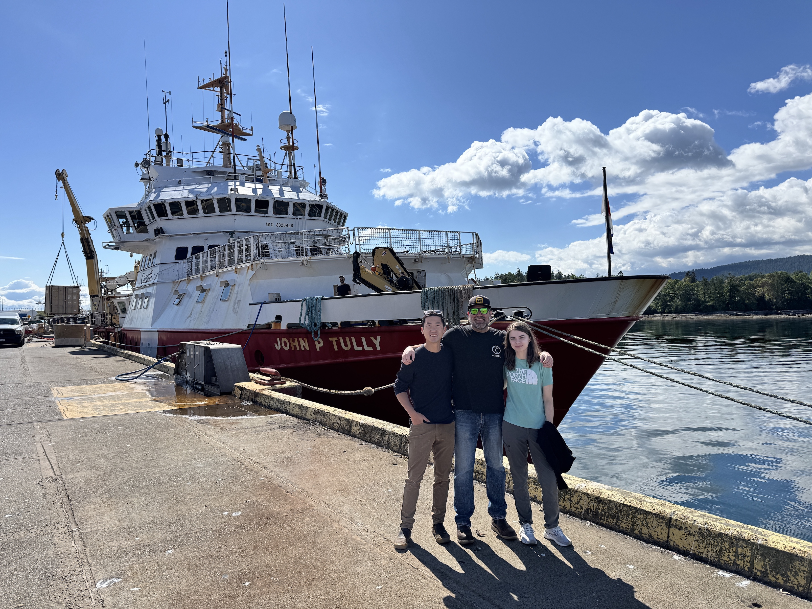

# PACE Validation Science Team - Particles and Biological Rates

In February 2024, NASA launched the [Plankton, Aerosol, Cloud, ocean Ecosystem (PACE)](https://pace.oceansciences.org/about.htm) satellite to improve how we observe our changing oceans from space. Its Ocean Color Instrument (OCI) measures light across hundreds of wavelengths, allowing scientists to investigate subtle differences in ocean color associated with phytoplankton communities and other constituents of seawater.

Phytoplankton form the base of marine food webs and play a central role in the global carbon cycle by converting carbon dioxide into organic matter through photosynthesis. Changes in their biomass, community composition, and productivity can influence how carbon and energy move through marine ecosystems. PACE's hyperspectral observations offer new opportunities to investigate these processes across vast areas of the ocean, but interpreting satellite measurements requires accurate observations collected directly from seawater.

At Oregon State University, [Dr. Jason Graff](https://bpp.oregonstate.edu/directory/people/jason-graff) leads our group as part of NASA’s [PACE Validation Science Team](https://pace.oceansciences.org/pvstdoi.htm). Our goal is to evaluate how accurately satellite observations represent phytoplankton carbon biomass, particulate organic carbon, and biological rates across different marine environments.

```{r, echo=FALSE, fig.cap= "In May 2025, we made measurements on the Canadian Coast Guard Ship John P. Tully in collaboration with scientists from the Line P and La Perouse long-term sampling programs, covering both coastal-shelf and open ocean ecosystems.", out.width = '90%', fig.align='center'}

```

We collect biological, biogeochemical, and bio-optical measurements aboard research vessels, including observations coordinated with satellite overpasses. These measurements include phytoplankton carbon biomass and abundance, particulate organic carbon (POC), net primary production (the rate at which phytoplankton fix carbon through photosynthesis), and optical properties such as light absorption and scattering.

By comparing these measurements with satellite observations, we can evaluate and improve the algorithms used to estimate biological and biogeochemical properties from ocean color. This work also helps us understand how relationships between optical signals and underlying biological processes vary among marine environments.

Our fieldwork has included cruises in the northeast Pacific and South Atlantic, providing opportunities to examine these relationships across coastal and open-ocean ecosystems. In November 2025, we joined the [SPARC expedition](https://schmidtocean.org/cruise/searching-for-the-asgard/) aboard the R/V Falkor (too) as a cruise of opportunity, collecting biological, biogeochemical, and bio-optical measurements in support of PACE validation while the expedition pursued its primary microbiological objectives. Read more about our work off Uruguay in Dr. Graff's NASA [Notes from the Field](https://science.nasa.gov/blogs/notes-from-the-field/2026/04/27/off-uruguay-pace-partners-connect-data-from-satellite-and-sea/). 
